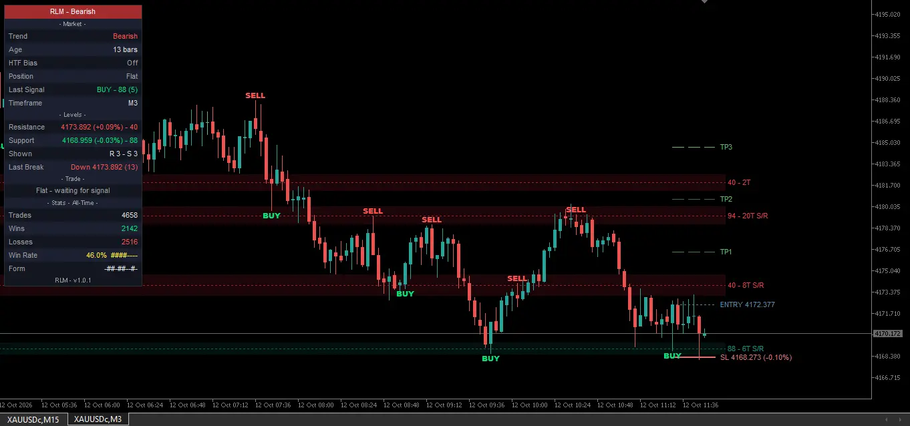
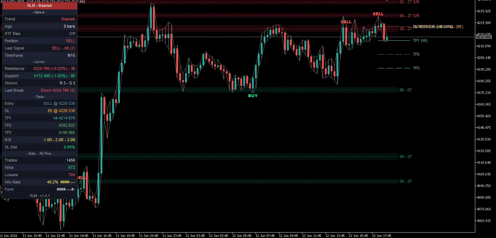
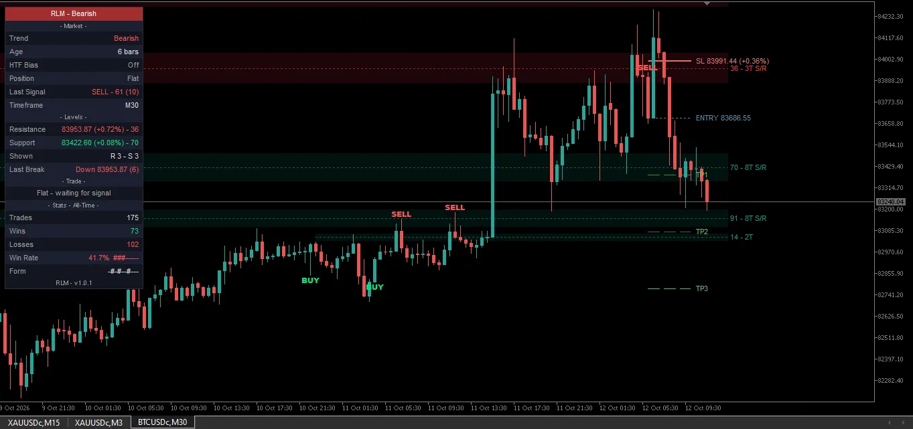
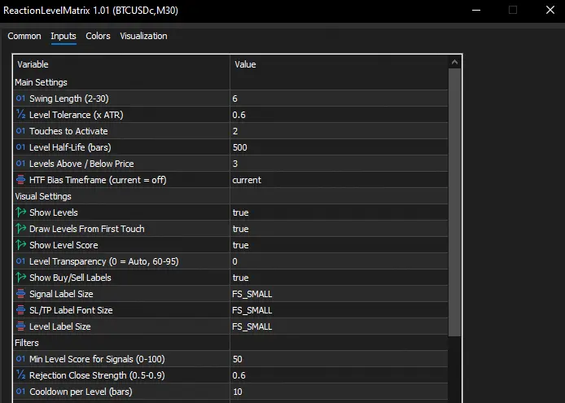
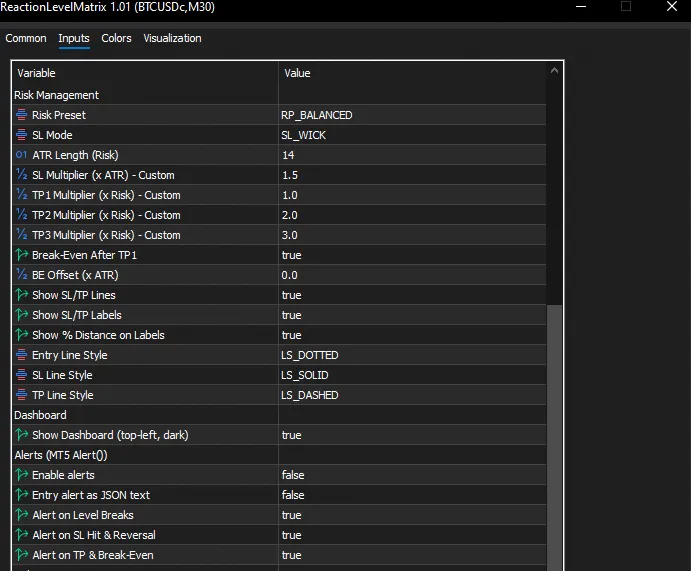
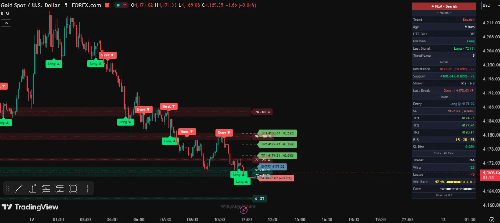

# Reaction Level Matrix MT5 Indicator

**Reaction Level Matrix MT5 Indicator** is an open-source MQL5 port of **Reaction Level Matrix [WillyAlgoTrader]**. It builds reaction-weighted support and resistance bands, assigns each level a 0–100 strength score, identifies closed-bar rejections, and draws a virtual entry, stop, and three-target trade plan.

**Platform:** MetaTrader 5 desktop · **Source version:** `1.02` · **Dashboard version:** `v1.0.2` · **License:** MPL-2.0 · **MT5 port maintainer:** AlgoToolbox (atoskueko)

> This is an indicator, not an Expert Advisor. The dashboard's BUY/SELL position, stop, targets, and trade statistics belong to an internal simulation. They do not represent orders or positions in your trading account.

## Project links

- **AlgoToolbox MT5 guide:** https://algotoolbox.com/products/reaction-level-matrix-mt5/
- **Original Pine script by WillyAlgoTrader:** https://www.tradingview.com/script/kcyXDIFe-Reaction-Level-Matrix-WillyAlgoTrader/
- **Project license:** [Mozilla Public License 2.0](LICENSE)

**Guide status:** The AlgoToolbox URL is the planned product-page address. The article was not yet published when this README was prepared. The link will become available after that page is published.

**Version note:** The repository source declares `1.02` and uses `v1.0.2` in its dashboard. The MT5 screenshots below show the earlier `1.01` / `v1.0.1` build. They illustrate the interface and workflow, not a version-matched validation of the current source. The TradingView reference image shows `v1.0.0`.

## Contents

- [Overview](#overview)
- [Chart examples](#chart-examples)
- [Install and compile](#install-and-compile)
- [Calculation and signal workflow](#calculation-and-signal-workflow)
- [Virtual trade plans and statistics](#virtual-trade-plans-and-statistics)
- [Inputs and defaults](#inputs-and-defaults)
- [Alerts](#alerts)
- [Indicator buffers](#indicator-buffers)
- [MT5-specific differences](#mt5-specific-differences)
- [Limitations and validation status](#limitations-and-validation-status)
- [License and attribution](#license-and-attribution)
- [Support](#support)

## Overview

The indicator evaluates confirmed swing highs and lows. A swing that produced a larger move away from its extreme receives more weight than a small reaction. Nearby swings join an existing level; their weighted prices determine its center and band width. Level strength ages, loses weight after a close through the band, and receives a scoring bonus when the level has been touched by both swing highs and swing lows.

The engine then selects the nearest eligible support and resistance levels. A rejection must satisfy the approach, touch, close-location, minimum-score, and per-level cooldown conditions before it becomes a signal.

### What it does

- Draws support and resistance bands, center lines, and strength labels.
- Scores levels on a saturating 0–100 scale.
- Tracks polarity levels that have acted as both support and resistance.
- Produces closed-bar rejection signals and separate virtual-entry events.
- Draws an entry, stop, TP1, TP2, and TP3 for the current or most recent virtual trade.
- Tracks virtual break-even, stop, target, and reversal events.
- Shows market, level, virtual-trade, and outcome information in a dashboard.
- Exposes six non-drawing indicator buffers for programmatic inspection.
- Optionally displays native MT5 alerts.

### What it does not do

- Place, modify, partially close, or close real orders.
- Size positions, calculate account risk, or model account equity.
- Provide a session filter, economic-news filter, or automatic execution layer.
- Use higher-timeframe bias as an entry filter; that field is informational.
- Send HTTP webhooks, email, or push notifications.
- Treat a level score as a probability of a successful trade.
- Provide an MT4 build.

The source uses price data rather than trading volume. The screenshots show `XAUUSDc` and `BTCUSDc`; they do not establish performance on every instrument or timeframe.

## Chart examples

All MT5 chart examples in this section are from the earlier `v1.0.1` build. Dashboard counts are virtual, history-dependent outcomes, not broker fills or account-performance reports.

### XAUUSDc M3



The chart shows nearby red resistance bands, a green support band, BUY/SELL entry labels, and the last virtual trade's levels. A Flat dashboard can coexist with visible entry/stop/target lines: those lines remain as a record until the next virtual entry.

### XAUUSDc M15



The dashboard shows TP1 reached and a virtual stop at entry. This is a trade-plan state, not a partial close or a live position. Entry and stop text can overlap when both prices coincide.

### BTCUSDc M30



The symbol and timeframe differ from the gold examples. Do not compare their displayed outcome percentages as if the charts were a controlled cross-market test.

## Install and compile

### Requirements

- MetaTrader 5 desktop with MetaEditor.
- A chart with sufficient OHLC history.
- The repository's `ReactionLevelMatrix.mq5` source file.

The source has no external include files or library imports. No compiled `.ex5` is included in this source package. Compilation and terminal-build compatibility have not been established by this documentation alone.

### Installation

1. Download the repository files.
2. In MetaTrader 5, choose **File → Open Data Folder**.
3. Place `ReactionLevelMatrix.mq5` in `MQL5/Indicators/`, or a subfolder such as `MQL5/Indicators/AlgoToolbox/`.
4. Open the file in MetaEditor and press **F7** to compile it. Review any errors and warnings before continuing. A successful compilation creates `ReactionLevelMatrix.ex5` beside the source.
5. Refresh **Navigator → Indicators**, or restart the terminal, then attach the indicator to a chart.
6. Start with the defaults and a dark chart background. Allow the terminal to load enough historical bars.
7. Check the **Experts** and **Journal** tabs if the indicator does not initialize or draw.
8. To receive pop-up alerts, set `InpAlertsOn` to `true`. Alerts are disabled by default.

The Algo Trading switch is not required for this indicator's analysis or virtual trade tracking. Only one instance per chart is recommended because the current chart-object prefix is chart-based, not instance-specific.

## Calculation and signal workflow

The MT5 implementation processes historical bars from oldest to newest and excludes the forming bar from persistent trading-state updates. At each completed bar, the engine follows this order:

1. **Confirm swings.** A candidate extreme needs `InpSwingLen` bars on each side. With the default of 6, a pivot becomes known six bars after its extreme.
2. **Measure reactions.** Measure the move away from the swing during its right-hand confirmation bars. Normalize it by the structure ATR at the swing when available.
3. **Maintain levels.** Age their strength, update support/resistance roles, apply crossing penalties, and remove levels whose strength has decayed below the threshold.
4. **Cluster the confirmed swings.** Join the nearest center within tolerance, or create a new level. Refit bands and merge overlaps after a joined touch.
5. **Select eligible levels.** Select the nearest active support and resistance levels, up to `InpLevelsSide` on each side.
6. **Evaluate rejections.** Apply the bar-close conditions, score threshold, and per-level cooldown.
7. **Update the virtual trade.** Resolve target/stop events, break-even, closure, reversal, and any new virtual entry.
8. **Write outputs.** Update event buffers, chart objects, dashboard values, and enabled alerts.

### Reaction weights and bands

The structure ATR period is a constant **34**. It is separate from the configurable risk ATR.

```text
Swing-high reaction = (pivot high - lowest low in confirmation bars) / ATR at pivot
Swing-low reaction  = (highest high in confirmation bars - pivot low) / ATR at pivot
Touch weight        = 1 + min(reaction, 2.5)

Level center = sum(weight × price) / sum(weight)
Variance     = sum(weight × price²) / sum(weight) - center²
Half-width   = clamp(sqrt(max(variance, 0)), 0.15 × ATR, tolerance × ATR)
```

The band refit uses the structure ATR on the bar where the touch or merge is processed. Strength decay does not decay the stored weighted price sums. At most **60 levels** are retained; the weakest by strength is removed when the cap is exceeded.

### Strength and score

```text
Touch:           strength += touch weight
Each bar:        strength *= 0.5^(1 / effective half-life)
Active crossing: strength *= 0.7
Forget level:    strength < 0.25
Polarity factor: 1.25 if both swing highs and swing lows contributed; otherwise 1.0
Score:           100 × (1 - exp(-(strength × polarity factor) / 6))
```

A label such as `71 - 5T S/R` means a score rounded to 71, five swing touches, and contributions from both swing highs and swing lows. The score describes accumulated, aged reactions; it is not a calibrated win probability.

A close above a band assigns support, a close below assigns resistance, and a close inside retains the previous role. The dashboard Trend follows breaks of previously selected levels; it is not an independent directional entry filter.

### Long rejection

The selected level must already be support before the current bar, and:

- `low <= band top`;
- `close > band top`;
- `(close - low) / (high - low) >= InpRejectClv`;
- its score is at least `InpMinScore`;
- its cooldown has elapsed.

A short rejection mirrors these conditions at resistance. The implementation gives the long signal precedence if both raw checks qualify.

### Raw signal versus virtual entry

A qualifying rejection does not always create a new virtual entry. Same-direction signals while that virtual direction is already open are ignored by the trade engine. BUY/SELL chart labels mark **virtual entries**, not every raw rejection. Buffers expose both event types separately.

Increasing the selected-level count can change signal eligibility. In contrast, hiding level drawings or entry labels does not disable the underlying calculations.

## Virtual trade plans and statistics

### Stops and targets

The virtual entry is the signal bar's close. For the default Wick-Anchored stop:

```text
Long stop  = min(signal low - 0.25 × risk ATR, entry - 0.5 × risk ATR)
Short stop = max(signal high + 0.25 × risk ATR, entry + 0.5 × risk ATR)
```

In ATR mode, the stop distance is the effective SL multiplier times the risk ATR. Each target is a multiple of the initial entry-to-stop distance. The risk ATR defaults to **14**.

The preset values are:

| Preset | ATR-mode SL multiplier | TP1 | TP2 | TP3 |
| --- | --- | --- | --- | --- |
| `RP_CONSERVATIVE` | 2.5 × ATR | 1R | 2R | 4R |
| `RP_BALANCED` | 1.5 × ATR | 1R | 2R | 3R |
| `RP_AGGRESSIVE` | 1.0 × ATR | 1.5R | 2.5R | 4R |
| `RP_SCALPING` | 0.8 × ATR | 0.8R | 1.5R | 2R |
| `RP_CUSTOM` | `InpSlMult` | `InpTp1Mult` | `InpTp2Mult` | `InpTp3Mult` |

The preset's SL multiplier controls ATR mode. Wick-Anchored mode uses the wick/minimum-distance formula above. Targets still use their preset R multiples in either stop mode.

### Management and outcome definitions

- There is one virtual position at a time.
- Entry-bar highs and lows are not checked for target or stop touches.
- TP1 and TP2 are milestones, not partial closes.
- With `InpBE=true`, the first TP1 touch moves the virtual stop to entry plus the directional ATR offset.
- A newly moved break-even stop is not tested as the new stop on that same bar.
- TP3, a stop event, or an opposite signal closes the virtual trade. An opposite signal can then open a new direction.
- A closed trade is counted as a **win if TP1 was reached**, even if its eventual exit is at break-even, at a stop, or on reversal. Otherwise it is counted as a loss.

**The intrabar model is optimistic.** A first TP1 or TP3 touch suppresses a competing stop closure on that bar; TP3 can also take priority over a stop touch. OHLC bars do not establish the real sequence of those touches. There is no spread, commission, slippage, position sizing, or monetary P/L model.

`Trades` counts closed virtual trades. `Win Rate` is the TP1-based win count divided by the closed virtual-trade count. `Form` shows the last ten outcomes using `#` and `-`. Current source configuration uses **All-Time**, meaning the history loaded for the calculation—not an account's trading history. Reinitialization reconstructs the counts from the available bars.

A dashboard Position can oppose the dashboard Trend because Trend is context rather than a trade-direction filter. A Flat dashboard can retain the previous trade's chart lines.

## Inputs and defaults

These defaults describe the repository's `1.02` source. The input screenshots show an earlier build and are visual references only.

### Main settings

| Input | Default | Effect |
| --- | --- | --- |
| `InpSwingLen` | `6` | Bars on each side of a pivot. Source comment labels the range 2–30; the effective calculation uses at least 2. |
| `InpLevelTol` | `0.6` | ATR-normalized join distance and maximum band half-width. |
| `InpMinTouches` | `2` | Touches required before a level is eligible for selection/signals. |
| `InpHalfLife` | `500` | Strength half-life in bars. Effective value is at least 50. |
| `InpLevelsSide` | `3` | Maximum selected support levels and resistance levels, per side. |
| `InpHtfTF` | `PERIOD_CURRENT` | HTF bias off. A higher timeframe displays previous-closed-bar close versus EMA 50. |

### Signal filters

| Input | Default | Effect |
| --- | --- | --- |
| `InpMinScore` | `50` | Minimum score for a rejection signal. |
| `InpRejectClv` | `0.6` | Required close location within the signal candle's range. |
| `InpCooldown` | `10` | Minimum bars since the last raw signal at that level. |

### Virtual risk and trade-plan settings

| Input | Default | Effect |
| --- | --- | --- |
| `InpPreset` | `RP_BALANCED` | Selects the preset SL/target multipliers. |
| `InpSlMode` | `SL_WICK` | Wick-Anchored stop; `SL_ATR` selects an ATR-distance stop. |
| `InpAtrLenRisk` | `14` | Risk ATR period; effective calculation uses at least 1. |
| `InpSlMult` | `1.5` | Custom preset's ATR-mode SL multiplier. |
| `InpTp1Mult` | `1.0` | Custom preset's TP1 multiple of initial risk distance. |
| `InpTp2Mult` | `2.0` | Custom preset's TP2 multiple. |
| `InpTp3Mult` | `3.0` | Custom preset's TP3 multiple. |
| `InpBE` | `true` | Move the virtual stop after the first TP1 touch. |
| `InpBeOffset` | `0.0` | Directional offset beyond entry, in ATR at entry. |
| `InpShowSlTp` | `true` | Draw virtual entry, stop, and target lines. |
| `InpShowSlTpLbl` | `true` | Show their text labels. |
| `InpShowPct` | `true` | Append percentage distance to the stop label. |
| `InpEntryStyle` | `LS_DOTTED` | Entry line style. |
| `InpSlStyle` | `LS_SOLID` | Stop line style. |
| `InpTpStyle` | `LS_DASHED` | Unreached target line style. |

The Custom multiplier inputs do not override another selected preset. With `InpSlMode=SL_WICK`, changing the Custom SL multiplier does not replace the wick-stop formula.

### Visual settings

| Input | Default | Effect |
| --- | --- | --- |
| `InpShowLevels` | `true` | Draw level bands and center lines. |
| `InpDrawFromFirst` | `true` | Anchor a band's drawing to its earliest contributing pivot; otherwise use activation time. |
| `InpShowLvlLabels` | `true` | Show score, touch count, and polarity text. |
| `InpZoneTransp` | `0` | Auto uses 88; a nonzero accepted value is clamped to 60–95. |
| `InpShowSignals` | `true` | Draw BUY/SELL virtual-entry labels. |
| `InpSignalFont` | `FS_SMALL` | Entry-label font size. |
| `InpLabelFont` | `FS_SMALL` | Entry/stop/target label font size. |
| `InpLevelFont` | `FS_SMALL` | Level-label font size. |
| `InpShowDash` | `true` | Show the dashboard. Position, section selection, font size, and statistics period are not user inputs in this build. |
| `InpMaxSigMarks` | `300` | Maximum retained entry labels; this does not cap the outcome counter or historical buffers. |

Font choices are `FS_TINY`, `FS_SMALL`, `FS_NORMAL`, `FS_LARGE`, and `FS_HUGE`. Line styles are `LS_SOLID`, `LS_DASHED`, and `LS_DOTTED`.

### Alert settings

| Input | Default | Effect |
| --- | --- | --- |
| `InpAlertsOn` | `false` | Master switch for native MT5 `Alert()` messages. |
| `InpWebhookJson` | `false` | Format new-entry alert text as JSON; does not transmit a webhook. |
| `InpAlertBreak` | `true` | Enable level-break messages when the master switch is on. |
| `InpAlertSlRev` | `true` | Enable stop and reversal messages. |
| `InpAlertTpBe` | `true` | Enable target and break-even messages. |

### Colors and informational fields

| Input | Default | Effect |
| --- | --- | --- |
| `InpBullColor` | `C'0,230,118'` | BUY label color (`#00E676`). |
| `InpBearColor` | `C'255,82,82'` | SELL label color (`#FF5252`). |
| `InpSupColor` | `C'8,153,129'` | Support band/label color (`#089981`). |
| `InpResColor` | `C'242,54,69'` | Resistance band/label color (`#F23645`). |
| `InpInfoTelegram` | `https://t.me/algotoolbox` | Informational input string; not used to send messages. |
| `InpInfoHomepage` | `https://algotoolbox.com` | Informational input string; not used for network requests. |

The dashboard's branding text is hardcoded. Editing the two informational inputs does not replace that footer text.

### Input screenshots





## Alerts

Set `InpAlertsOn=true` to enable native pop-up messages. The event categories include break-even, TP1/TP2/TP3, stop closure, reversal, new entry, and selected-level breaks. They are generated by the completed-bar engine rather than by intrabar price touches in real time.

`InpWebhookJson=true` changes the **entry message text** to JSON with direction, ticker, timeframe, reference price, score, SL, TP1–TP3, and the TP1 R multiple. It does not make an HTTP request or create a webhook integration. Stop, target, break-even, reversal, and level-break messages remain plain text.

Historical bulk processing suppresses alerts for older bars. The most recent closed bar is processed outside that bulk suppression on a full calculation, so enabling alerts can also produce its events when the indicator is attached or history is rebuilt. Do not assume every message on attachment represents a newly elapsed bar.

## Indicator buffers

All six plots use `DRAW_NONE`; visible chart lines and labels are objects. Buffer numbers are zero-based.

| Buffer | Plot label | Value on an event bar |
| --- | --- | --- |
| `0` | `long_entry` | `1.0` when the virtual engine opens a long. |
| `1` | `short_entry` | `1.0` when it opens a short. |
| `2` | `long_signal` | `1.0` when a raw long rejection qualifies. |
| `3` | `short_signal` | `1.0` when a raw short rejection qualifies. |
| `4` | `entry_sl` | Initial virtual SL price on a new-entry bar. |
| `5` | `entry_tp1` | Initial virtual TP1 price on a new-entry bar. |

Other values are `EMPTY_VALUE`, including the forming bar. Entry/signal buffers contain flags, not entry prices. The two price buffers are event outputs, not continuously updated active-position levels; they do not publish later break-even changes. TP2, TP3, score, and active-position state are not exported as separate buffers in this source.

The arrays are stored internally oldest-first. A consumer reading through normal MT5 buffer APIs should still request a completed bar rather than the forming bar. Reading these outputs does not turn the indicator itself into an automated trading system.

## MT5-specific differences

This build implements the reaction-level architecture, but the current materials do not establish exact calculation or display parity with a version-matched Pine build.

- **Closed-bar display refresh:** selected levels and dashboard values follow the last completed MT5 bar. The Pine reference can reselect displayed levels using the live close.
- **Dashboard configuration:** top-left position, small font, all four sections, and All-Time statistics are hardcoded. `InpShowDash` is the available dashboard toggle.
- **Theme:** a dark palette is used. This source does not expose the Pine Auto/Dark/Light theme selector.
- **Labels:** MT5 uses BUY/SELL text, `S/R` polarity notation, and `#`/`-` outcome characters rather than the Pine presentation.
- **Alerts:** native `Alert()` text replaces TradingView's alert configuration. JSON formatting is not webhook delivery.
- **Additional MT5 outputs:** six event buffers, a retained-entry-label cap, informational contact inputs, and AlgoToolbox dashboard branding.
- **Validation behavior:** an HTF below the chart timeframe logs a message and disables bias rather than stopping the whole indicator. Selecting the chart timeframe also leaves HTF bias off.

### TradingView visual reference



Original Pine indicator by WillyAlgoTrader. TradingView and author attribution are retained in the image. This is a different feed and timeframe from the MT5 examples, not a synchronized side-by-side comparison or proof of parity.

## Limitations and validation status

### Important limits

- **Confirmation delay:** pivots are known only after their right-hand bars complete. Drawing a level from its first touch places geometry into earlier chart history; it does not mean the level was known at that earlier time.
- **Changing level geometry:** new touches and merges can move or widen a displayed band. Historical entries were evaluated against the state available at their evaluation time.
- **History dependence:** changing the available history, settings, symbol, or timeframe rebuilds state. A closed-bar design is not a promise that all historical outputs remain identical after data revisions or a different history start.
- **Warm-up:** signals require the larger of 34 bars and `2 × effective swing length + 1` by bar index. The calculation routine also waits for at least that warm-up value plus five loaded bars.
- **Optimistic outcomes:** TP-priority and TP1-based win classification are not broker execution or monetary profitability.
- **Dark-chart readability:** a light chart is not the intended presentation. A zero-offset break-even stop shares the entry price, so chart text can overlap.
- **Multiple instances:** the current object prefix uses the chart ID. Two copies on one chart can affect each other's objects; use separate charts.
- **Partial input validation:** not every range printed in an input comment is enforced. Keep values within documented bounds. Invalid custom target ordering, nonpositive effective SL multipliers, oversized break-even offsets, and certain transparency values can prevent initialization.
- **Marker cap:** older entry labels are removed after `InpMaxSigMarks`; the panel can therefore count more historical trades than the chart currently labels.
- **Reinitialization:** dashboard outcomes are reconstructed from the loaded chart history rather than preserved as an account-level ledger.

### What is established here

- The documentation describes the current `ReactionLevelMatrix.mq5` declarations and implementation.
- The example screenshots show MT5 chart layouts and inputs from an earlier build.
- The repository provides source rather than a claimed certified binary release.

**MetaEditor compilation, current-version terminal execution, reload equivalence, and matched-data Pine/MT5 parity have not been established by these materials.** Screenshot outcome counts must not be presented as verified strategy backtests.

Before making a parity claim, use the same OHLC dataset, history start, timeframe, and settings; then compare pivot ties, ATR initialization, weighted bands, level merges, raw signals, virtual entries, and same-bar TP/SL outcomes. These are validation tasks, not completed results.

## License and attribution

The ported MQL5 source is distributed under **Mozilla Public License 2.0**. See [LICENSE](LICENSE) for the full text and [NOTICE.md](NOTICE.md) for provenance and attribution.

- **Original work and Pine logic:** Reaction Level Matrix [WillyAlgoTrader], by WillyAlgoTrader.
- **MT5 adaptation and maintenance:** AlgoToolbox (atoskueko).
- **Upstream licensing basis:** the inspected public Pine source contains no separate license declaration. [TradingView's Terms of Use, Section 22](https://www.tradingview.com/policies/) apply MPL-2.0 by default to a script without a license in its comments.

Keep the original notices and license information when redistributing the covered source. If distributing a compiled build, make the corresponding covered source available and tell recipients where to obtain it. Do not substitute a compiled-only freeware EULA for recipients' MPL rights in this code. The [MPL 2.0 FAQ](https://www.mozilla.org/en-US/MPL/2.0/FAQ/) explains the file-level requirements.

The MPL code-license notice is not a blanket license for screenshots, third-party logos, chart interfaces, or the original author's branding. The visual reference retains its existing attribution. No affiliation with or endorsement by the original author, TradingView, or MetaQuotes is implied.

## Support

For a reproducible issue report, include the source version, MT5 build, symbol exactly as your broker names it, timeframe, relevant inputs, history range, and any Experts/Journal messages. Include a screenshot and the expected versus actual behavior. Do not post account credentials.

- **AlgoToolbox:** https://algotoolbox.com/
- **Telegram:** https://t.me/algotoolbox

This project is for chart analysis, education, and independent testing. Trading involves financial risk; indicator scores and virtual outcome statistics do not establish future trading returns.
